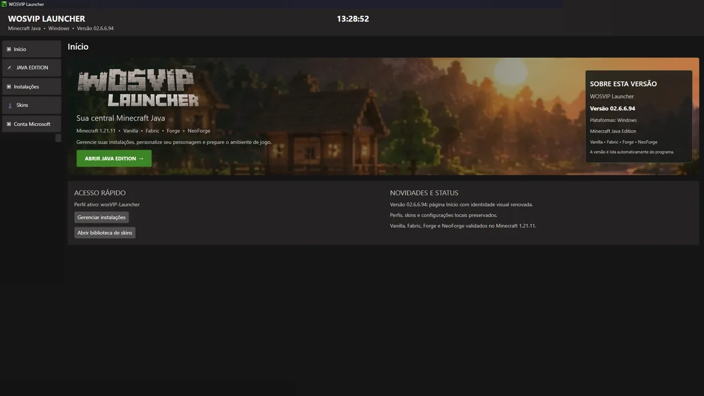
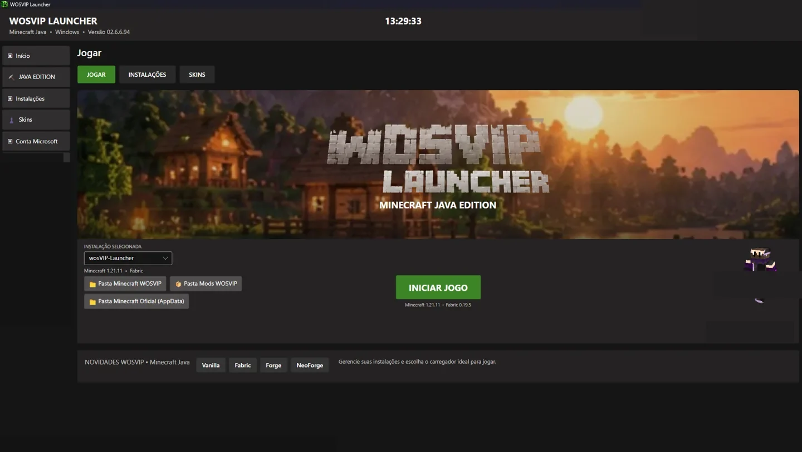
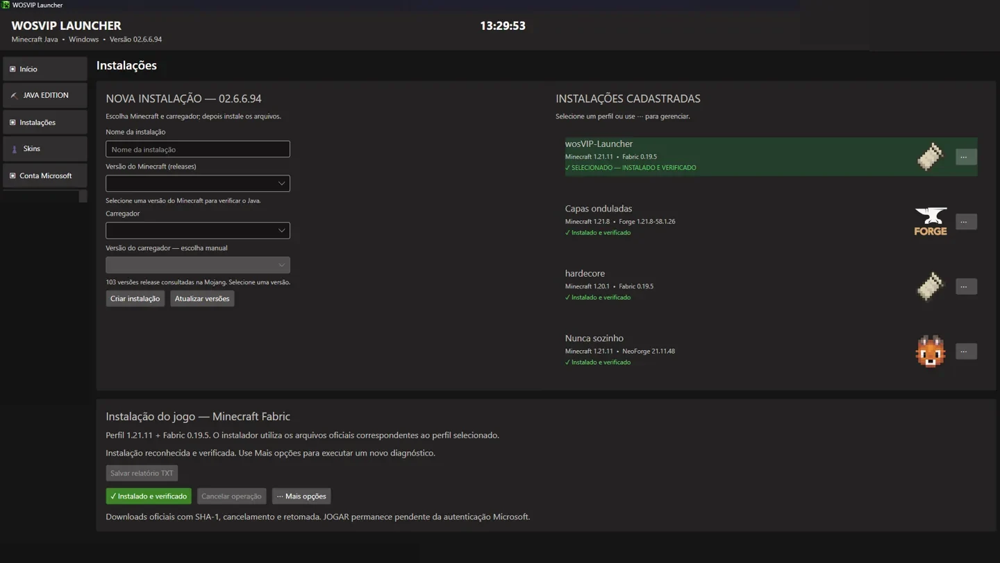
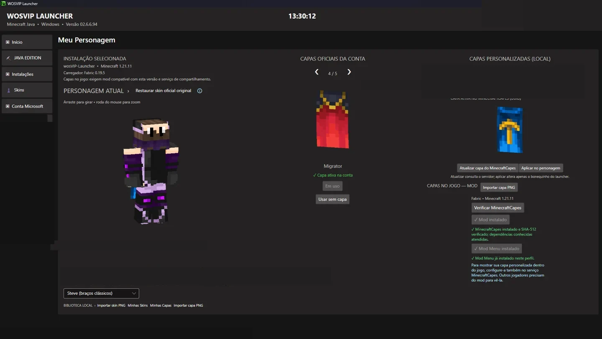
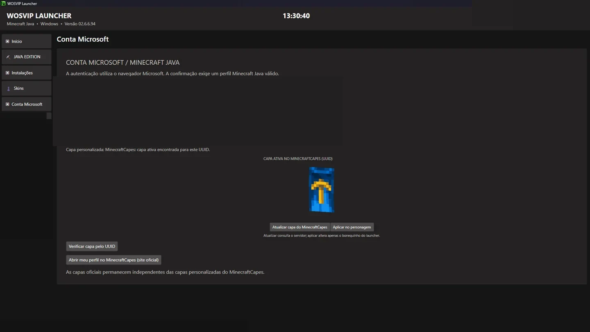
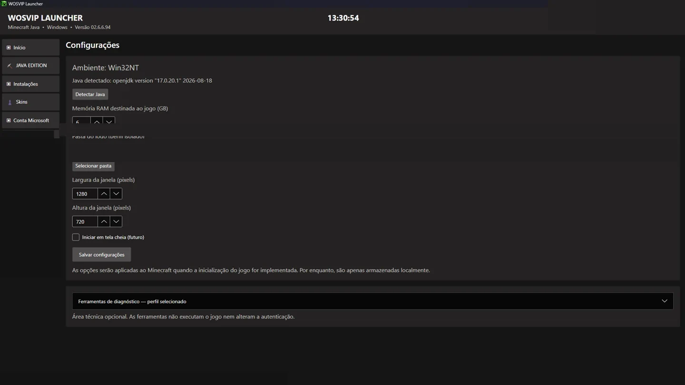

# WOSVIP Launcher
**Minecraft Java Edition para Windows · Versão 02.6.6.94**

Launcher independente para gerenciar instalações, escolher carregadores e personalizar seu personagem.

[**Site do projeto**](https://wosvip.github.io/wosvip-launcher/) · [**Releases**](https://github.com/wosvip/wosvip-launcher/releases)

> **Versão 02.6.6.94:** testada localmente no Windows 11. A distribuição pública do instalador e a verificação de atualizações pelo GitHub ainda serão preparadas.

## Conheça o launcher

### Recursos validados
- Perfis Minecraft Java com **Vanilla, Fabric, Forge e NeoForge**.
- Login Microsoft e restauração de sessão com conta Minecraft Java válida.
- Visualização 3D de skins, capas oficiais e integração com **MinecraftCapes**.
- Gerenciamento de instalações e atalhos para pastas do Minecraft e mods.
- Detecção de Java, ajustes de RAM e resolução e ferramentas de diagnóstico.
- Minimização do launcher ao abrir o jogo e restauração ao encerrar, nos testes locais.

## Telas
| Jogar | Instalações |
|---|---|
|  |  |

| Personagem, skins e capas | Conta Microsoft |
|---|---|
|  |  |

## Distribuição e próximos passos
Consulte [Releases](https://github.com/wosvip/wosvip-launcher/releases) para verificar se há instalador publicado. A futura consulta a atualizações usará o GitHub Releases, com aviso e instalação **somente mediante autorização**. Esse mecanismo ainda não está implementado.

## Aviso
Projeto independente e não oficial, sem vínculo, patrocínio ou endosso da Microsoft, Mojang ou Minecraft. Destinado a usuários com licença válida do Minecraft: Java Edition. Não contorna autenticação nem verificações de propriedade do jogo.
